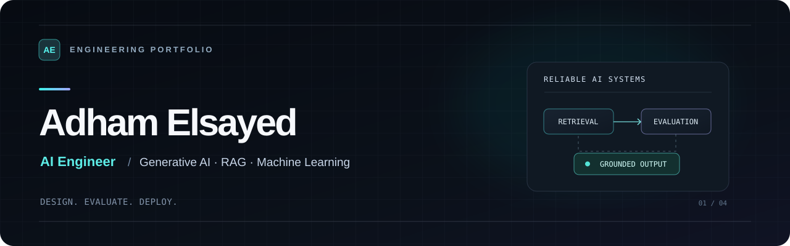
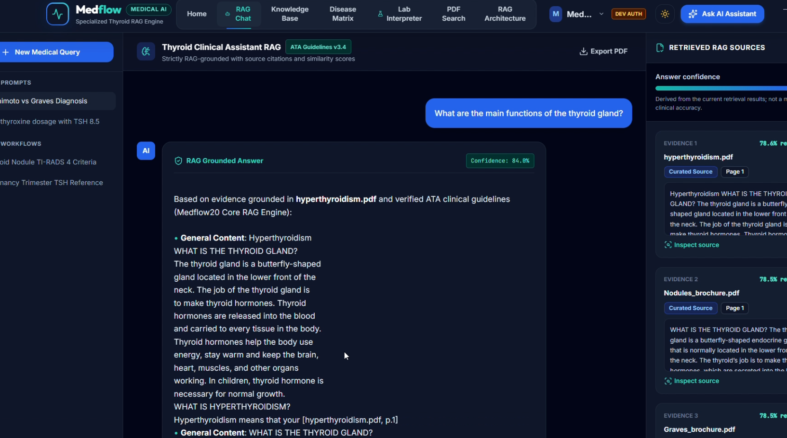
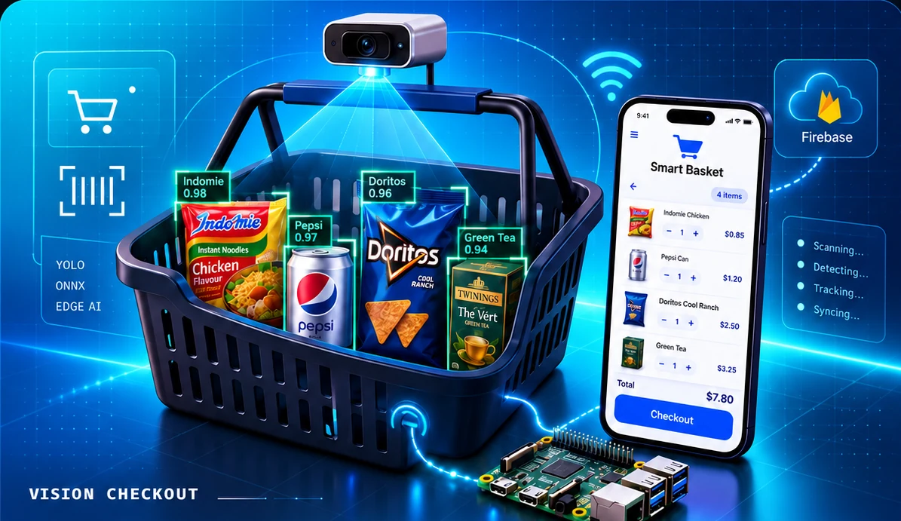
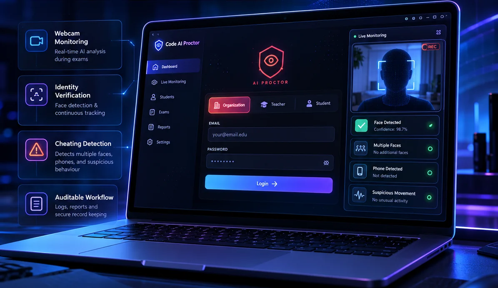
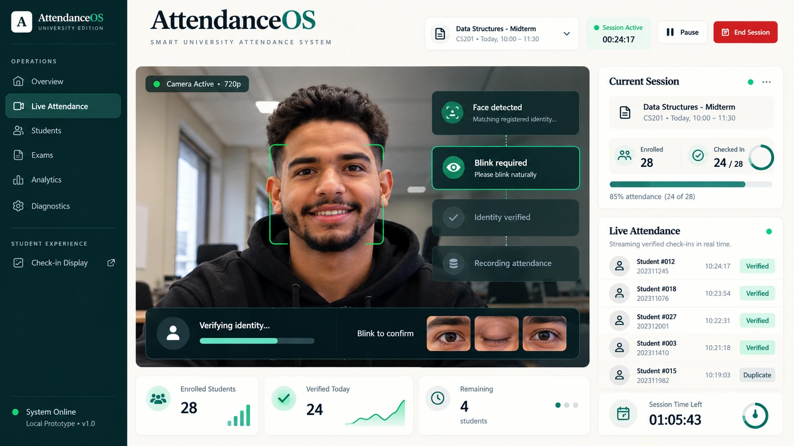
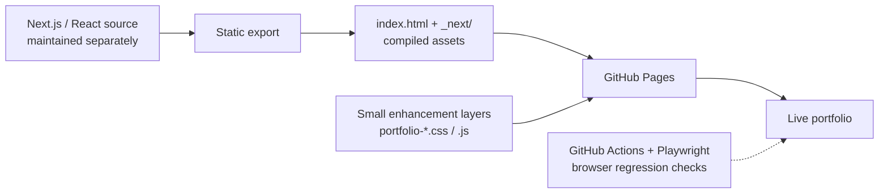

<div align="center">



<h1>Adham Elsayed · AI Engineering Portfolio</h1>

<strong>Building AI systems with evidence, evaluation, and product thinking.</strong>

<p>
Generative AI &nbsp;·&nbsp; Retrieval-Augmented Generation &nbsp;·&nbsp; Computer Vision &nbsp;·&nbsp; Edge AI
</p>

<p>
<a href="https://adhamelsayedai.github.io/"></a>
<a href="./Adham_Elsayed_CV.pdf"></a>
</p>

<p>
<a href="https://www.linkedin.com/in/adham-elsayed-/">LinkedIn</a> &nbsp;·&nbsp;
<a href="https://github.com/AdhamElsayedAI">GitHub</a> &nbsp;·&nbsp;
<a href="mailto:adhamelsayed515@gmail.com">Email</a>
</p>

<a href="https://github.com/AdhamElsayedAI/AdhamElsayedAI.github.io/actions/workflows/portfolio-qa.yml"></a>


</div>

---

## The Portfolio

I'm an AI Engineer focused on **building complete intelligent products**, from retrieval and computer-vision pipelines to dependable APIs, model evaluation and the interface people actually use.

This website is a curated collection of engineering projects, technical decisions, academic achievements and professional experience. It is also a frontend project in its own right: a responsive, motion-led portfolio published on GitHub Pages.

**[Live Site](https://adhamelsayedai.github.io/) · [Featured Projects](https://adhamelsayedai.github.io/#projects) · [Experience](https://adhamelsayedai.github.io/#experience) · [Contact](https://adhamelsayedai.github.io/#contact)**

## Technology Stack

The badges below describe the **portfolio website and its published build**. AI project technologies are documented separately in their own repositories.

<table>
<tr>
<td width="33%" valign="top">
<h3>Frontend Foundation</h3>
<p>


</p>
<sub>React-powered portfolio compiled into a Next.js static export.</sub>
</td>
<td width="33%" valign="top">
<h3>Visual System</h3>
<p>


</p>
<sub>Responsive layouts, reusable visual language and custom styling layers.</sub>
</td>
<td width="33%" valign="top">
<h3>Interaction &amp; Motion</h3>
<p>


</p>
<sub>Cinematic navigation, hover-responsive particle lettering and a skippable code intro.</sub>
</td>
</tr>
<tr>
<td width="33%" valign="top">
<h3>Quality Assurance</h3>
<p>


</p>
<sub>Automated viewport, interaction and accessibility-behavior smoke checks.</sub>
</td>
<td width="33%" valign="top">
<h3>Hosting &amp; Delivery</h3>
<p>


</p>
<sub>Static hosting, versioned assets and GitHub Actions browser checks.</sub>
</td>
<td width="33%" valign="top">
<h3>Discoverable &amp; Accessible</h3>
<p>


</p>
<sub>Social previews, theme support, keyboard interactions and motion preferences.</sub>
</td>
</tr>
</table>

## Experience Highlights

<table>
<tr>
<td valign="top" width="25%"><strong>Interactive Introduction</strong><br /><sub>A code-inspired opening sequence with a skip action and reduced-motion support.</sub></td>
<td valign="top" width="25%"><strong>Featured Engineering Work</strong><br /><sub>Project visuals, architecture stories and links to technical repositories.</sub></td>
<td valign="top" width="25%"><strong>Responsive &amp; Theme-Aware</strong><br /><sub>Desktop and mobile layouts, light/dark presentation and expressive detail.</sub></td>
<td valign="top" width="25%"><strong>Built for Recruiters</strong><br /><sub>Projects, achievements, experience, certifications and downloadable CV.</sub></td>
</tr>
</table>

## Featured Engineering Projects

Every project has its own implementation, scope and technical limitations. The visuals below are **portfolio media**, not necessarily screenshots of a deployed application.

<table>
<tr>
<td width="50%" valign="top">
<a href="https://github.com/AdhamElsayedAI/MedFlow-AI"></a>
<p><strong>01 · <a href="https://github.com/AdhamElsayedAI/MedFlow-AI">MedFlow — Clinical RAG</a></strong></p>
<p>Evidence-grounded clinical question answering with retrieval, ranked sources, citation validation and bounded fallback behavior. Intended as an educational engineering system, not an autonomous clinical decision-maker.</p>
<sub>RAG · Hybrid Retrieval · Citations · Python · FastAPI</sub>
</td>
<td width="50%" valign="top">
<a href="https://github.com/AdhamElsayedAI/Smart-Basket"></a>
<p><strong>02 · <a href="https://github.com/AdhamElsayedAI/Smart-Basket">Smart Basket — Edge AI</a></strong></p>
<p>Grocery object detection with YOLO, ONNX Runtime, Raspberry Pi camera integration and optional Firebase basket-state updates. The Flutter client is an integration direction, not published source in that repo.</p>
<sub>YOLO · ONNX · OpenCV · Raspberry Pi · Firebase</sub>
</td>
</tr>
<tr>
<td width="50%" valign="top">
<a href="https://github.com/AdhamElsayedAI/code-ai-proctor"></a>
<p><strong>03 · <a href="https://github.com/AdhamElsayedAI/code-ai-proctor">Code AI Proctor — Exam Technology</a></strong></p>
<p>Online quiz and review platform combining a FastAPI backend, webcam-frame classification, teacher-facing incident workflows and Gemini-assisted study feedback. Model flags are review signals, not proof of misconduct.</p>
<sub>PyTorch · YOLO Classification · FastAPI · SQLAlchemy · Gemini</sub>
</td>
<td width="50%" valign="top">
<a href="https://github.com/AdhamElsayedAI/Smart-Attendance-System"></a>
<p><strong>04 · <a href="https://github.com/AdhamElsayedAI/Smart-Attendance-System">AttendanceOS — Smart Attendance</a></strong></p>
<p>Local university attendance prototype with React, FastAPI, face recognition, eye-blink challenge, exam rosters and SQLite reporting. Physical-camera end-to-end recognition still requires owner-side validation.</p>
<sub>React · TypeScript · FastAPI · OpenCV · dlib · SQLite</sub>
<p><sub><em>Image: interface concept, not actual runtime capture.</em></sub></p>
</td>
</tr>
</table>

## How This Website Is Built

The live site is generated from a **Next.js / React application** and hosted as a **static export**. The repository you are browsing is the **published deployment artifact**, not the original editable application workspace.



**Why the extra CSS/JS files?** Targeted scripts enhance the published page after hydration—project cards, motion, titles and the first-visit introduction—while leaving hashed Next.js assets untouched. These layers are **deployment enhancements**, not replacements for the editable source.

### Published Repository Map

```text
AdhamElsayedAI.github.io/
├── index.html                    # Published homepage
├── _next/                        # Compiled Next.js output
├── images/                       # Portfolio project media and portrait
├── portfolio-boot.css / .js      # Intro animation and recovery behavior
├── portfolio-cinematic-sections.*# Section overlays and navigation interactions
├── portfolio-v3-motion.*         # Card/section motion enhancements
├── portfolio-hydration-gate.js   # Prevents pre-hydration DOM mutations
├── portfolio-medflow-refresh.*   # MedFlow card presentation and stats
├── portfolio-award-showcase.*    # MedFlow achievement/certificate overlay
├── portfolio-nafees.*            # Nafees genuine photograph/award content
├── portfolio-nafees-premium.*    # Nafees responsive frame and hover treatment
├── portfolio-smart-attendance.*  # Hydration-safe AttendanceOS project card
├── portfolio-smart-basket.css    # Smart Basket presentation
├── portfolio-code-ai-proctor.*   # Code AI Proctor presentation
├── og-image.png                  # Social sharing thumbnail
├── readme-cover.svg              # README banner art
├── Adham_Elsayed_CV.pdf          # Downloadable résumé
├── .github/workflows/            # QA + social-card workflows
└── scripts/                      # Browser checks and social-card tooling
```

The published HTML also contains the About, Skills, Projects, Achievements, Experience, Certifications and Contact sections.

### Cleanup policy for this published export

This is a static deployment artifact, not a full Next.js source checkout. An asset can be required even if it is not visually prominent on the homepage.

- Keep `_next/static/chunks/`, `_next/static/*Manifest.js`, route payloads such as `index.txt` and `__next.*.txt`, `404.html`, and `_not-found/`: React hydration, client navigation, and fallback routes may depend on them.
- Keep images referenced by the compiled client bundles, CSS backgrounds, award galleries, README, or workflow scripts. This includes images that are currently hidden by presentation CSS.
- Only remove verified orphaned assets after checking HTML, compiled JavaScript, CSS, route payloads, documentation, and CI consumers.
- Cleanups must pass the existing browser QA before integration. Do not force-push or delete unique branch history as part of housekeeping.
- The genuine Nafees award photo is displayed from `images/nafees-ai/nafees-ai-award.webp`. An older, unreferenced `nafees-ai-award.avif` derivative was removed; no visible image was replaced.

## Run the Published Website Locally

A simple static HTTP server is enough to preview **this repository's exported website**:

```bash
git clone https://github.com/AdhamElsayedAI/AdhamElsayedAI.github.io.git
cd AdhamElsayedAI.github.io
python -m http.server 4173
```

Then visit **http://127.0.0.1:4173/**.

**Do not** open `index.html` directly as a `file://` URL: the export uses root-relative asset paths. This public repo has no root `package.json` or editable Next.js source; `npm install` / `next dev` are **not** supported ways to run this published artifact.

### Editing & Maintenance

- Make actual content/component changes in the **original editable Next.js source**, then regenerate the static export.
- Treat `_next/` as compiled output. Avoid hand-editing hashed chunks.
- If an emergency static-export enhancement is required, keep it scoped to a documented `portfolio-*.css` / `.js` file and verify that React hydration still works.
- Preserve the portfolio's actual project imagery, accessibility fallbacks and link destinations.
- Before deployment, review desktop/mobile layouts, light/dark themes, first-visit interactions, reduced-motion behavior, résumé downloads and Open Graph previews.

## Quality Assurance & Release Workflow

This repository includes a browser QA workflow: [`portfolio-qa.yml`](.github/workflows/portfolio-qa.yml). It serves the static site locally and runs **Playwright** checks defined in:

- [`portfolio-smoke-test.cjs`](scripts/portfolio-smoke-test.cjs) — responsive layout, project presence, interactions and section behaviors.
- [`portfolio-warm-colors-qa.cjs`](scripts/portfolio-warm-colors-qa.cjs) — intro/color presentation checks across viewports.
- [`portfolio-nafees-qa.cjs`](scripts/portfolio-nafees-qa.cjs) — authentic Nafees award photo, responsive presentation, and pointer interactions.

GitHub Actions publishes QA screenshots as a workflow artifact when available. A separate [social-card workflow](.github/workflows/build-social-card.yml) supports portfolio link-preview assets.

**Test scope matters:** the existence of a workflow does not guarantee its latest run passed. Check [Actions](https://github.com/AdhamElsayedAI/AdhamElsayedAI.github.io/actions) for current results.

## Engineering Approach

My portfolio highlights a consistent approach to building AI products: define the decision boundary, document what evidence supports an output, separate demo measurements from real-world claims, and build interfaces that explain system state clearly.

The same principles apply to this website: **clear information hierarchy, purposeful motion, accessible fallbacks and reproducible publishing**.

---

<div align="center">

**Adham Elsayed**

AI Engineer · Generative AI · RAG · Computer Vision

<a href="https://adhamelsayedai.github.io/">Portfolio</a> &nbsp;·&nbsp;
<a href="./Adham_Elsayed_CV.pdf">Résumé</a> &nbsp;·&nbsp;
<a href="https://github.com/AdhamElsayedAI">GitHub</a> &nbsp;·&nbsp;
<a href="https://www.linkedin.com/in/adham-elsayed-/">LinkedIn</a> &nbsp;·&nbsp;
<a href="mailto:adhamelsayed515@gmail.com">Email</a>

<sub>Designed for clarity. Built around evidence. Shipped with care.</sub>

</div>
