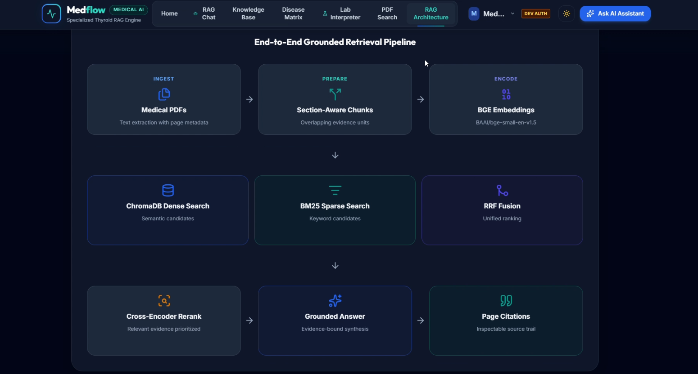

<div align="center">


<br />

**Evidence-grounded AI. Designed, evaluated, and built for real-world use.**

Generative AI · RAG Systems · Machine Learning · Computer Vision · AI Evaluation

<br />

[**Explore Portfolio ↗**](https://adhamelsayedai.github.io/) &nbsp; · &nbsp; [**View Résumé ↗**](./Adham_Elsayed_CV.pdf) &nbsp; · &nbsp; [**LinkedIn ↗**](https://www.linkedin.com/in/adham-elsayed-/) &nbsp; · &nbsp; [**Get in Touch ↗**](mailto:adhamelsayed515@gmail.com)

</div>

---

### About

I'm an AI Engineering student at **Mansoura University** focused on designing complete intelligent systems, from retrieval and model behavior to evaluation, APIs, and product integration. My work explores how Generative AI and computer vision can deliver practical, verifiable results—not just compelling demos.

This portfolio brings together the systems I've built, the engineering decisions behind them, and the evidence used to assess their behavior.

### Selected work

<a href="https://github.com/AdhamElsayedAI/MedFlow-AI"></a>

**01 / [MedFlow — Evidence-Grounded Clinical RAG](https://github.com/AdhamElsayedAI/MedFlow-AI)**

Hybrid dense and sparse retrieval with RRF fusion, evidence gates, citation validation, and bounded response states: answer, caution, abstain, or redirect.

<sub>Python · BGE · BM25 · RRF · ChromaDB · FastAPI</sub>

| | Additional systems | |
|:--|:--|:--|
| **02** | **[Smart Basket](https://github.com/AdhamElsayedAI/Smart-Basket)** | YOLO detection and ONNX edge inference on Raspberry Pi 5, connected to a Flutter/Firebase cart |
| **03** | **[Code AI Proctor](https://github.com/AdhamElsayedAI/code-ai-proctor)** | Webcam-based monitoring prototype, threshold alerts, and an auditable FastAPI workflow |
| **04** | **[Smart Attendance System](https://github.com/AdhamElsayedAI/Smart-Attendance-System)** | Face recognition, blink-based liveness checks, exam-scoped attendance, and Streamlit/SQLite records |

<details>
<summary><strong>Engineering evidence & measurement scope</strong></summary>

<br />

- **MedFlow retrieval:** Precision@4 **53.12%**, Hit@4 **87.50%**, and MRR **≈0.7031** on the documented 200-token, Top-K=4 setup.
- **MedFlow grounding:** A bounded seven-case evaluation reported valid citations and coverage across all seven cases. This is **not a clinical accuracy measurement**.
- **Smart Basket detection:** Reported results for a four-class evaluation: **96.89% mAP@0.5** and **84.79% mAP@0.5:0.95**.

</details>

### Engineering focus

| AI Systems | Implementation & Delivery |
|---|---|
| Grounded generation, hybrid RAG, embeddings, reranking | Python, FastAPI, REST APIs, SQL |
| Retrieval and citation evaluation, NLI, safety boundaries | PyTorch, YOLO, OpenCV, ONNX |
| Adaptive AI, computer vision, edge inference | Docker, Git, Firebase, Azure AI |

### The portfolio experience

<div align="center">



<sub>Authentic project UI used in the portfolio — not a generated mockup.</sub>

</div>

<br />

The website uses a dark/light theme, responsive layouts, accessible navigation, authentic project imagery, and subtle interface motion. Section dividers use continuously animated multicolor particle typography, pointer-reactive motion and a cinematic in-page navigation transition. With reduced motion, the particle titles remain visible without animation. Interactive cards respond to pointer position; animated section typography is a progressive enhancement and respects reduced-motion settings.

### For developers

This repository is the **published Next.js static export** served by GitHub Pages. It contains compiled assets rather than the original editable application source.

<details>
<summary><strong>Run locally and maintain the site</strong></summary>

<br />

From the repository root:

```bash
python -m http.server 4173
```

Visit **http://localhost:4173/**. A local server is necessary because assets use root-relative paths.

**Key files**

```text
index.html                         Published homepage
_next/                             Compiled Next.js assets
images/                            Original project imagery
portfolio-v3-fixes.css             Responsive refinements
portfolio-v3-motion.css / .js      Interaction and reveal motion
portfolio-v3-section-titles.css    Readable heading fallback
portfolio-v3-creative-letters.*    Per-letter heading animation
portfolio-smart-attendance.*      Hydration-safe Smart Attendance project card
portfolio-cinematic-sections.*     Particle section titles and section navigation overlay
Adham_Elsayed_CV.pdf               Current downloadable résumé
```

Do not edit hashed files under `_next/`. For major redesigns or content updates, make changes in the editable Next.js source and regenerate the export. Port any static-export enhancements into that source before rebuilding, or they may be overwritten.

**Pre-publish checks:** verify mobile and desktop layouts, light/dark themes, links and images, résumé download, keyboard interactions, and reduced-motion behavior.

</details>

---

<div align="center">

**Adham Elsayed** · AI Engineer · Mansoura, Egypt

[Website](https://adhamelsayedai.github.io/) &nbsp;·&nbsp; [GitHub](https://github.com/AdhamElsayedAI) &nbsp;·&nbsp; [LinkedIn](https://www.linkedin.com/in/adham-elsayed-/) &nbsp;·&nbsp; [Email](mailto:adhamelsayed515@gmail.com)

<sub>Built with a focus on measurable engineering, clear evidence, and responsible AI systems.</sub>

</div>
